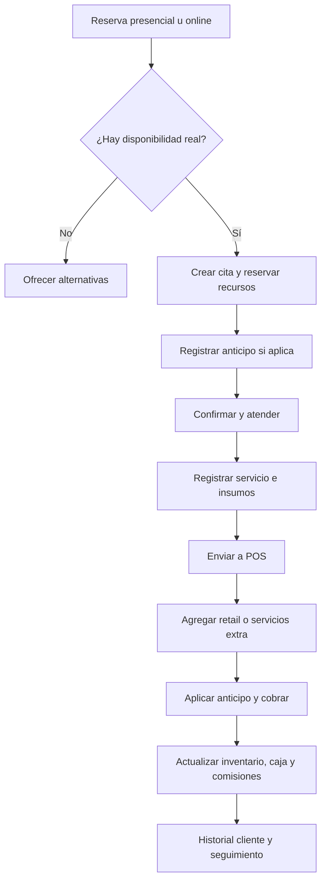
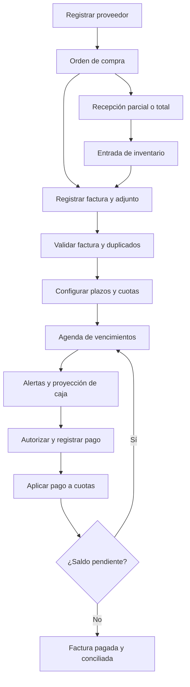

# 8.72 BUSINESS OS
## Especificación funcional, técnica, de experiencia de usuario y prompt maestro de desarrollo

**Proyecto:** 8.72 Business OS  
**Empresa:** 8.72 Hair Salon  
**Versión del documento:** 1.0  
**Fecha de elaboración:** 23 de octubre de 2026  
**Idioma:** Español  
**País y mercado inicial:** Ecuador  
**Moneda operativa:** USD  
**Zona horaria del negocio:** `America/Guayaquil`  
**Infraestructura objetivo:** hosting administrado mediante cPanel, sujeto a verificación de compatibilidad.  
**Estado:** especificación y plan de implementación. **Este documento no implica que el software esté programado o instalado.**

> **Identidad del producto:** Un sistema de gestión empresarial propio para salones de belleza, especializado inicialmente en la operativa de 8.72 Hair Salon. Adoptará patrones funcionales consolidados de gestión de reservas y caja, con diseño, código, marca, modelo de datos y experiencia originales. No se copiarán elementos protegidos, bases de datos, código, pantallas o activos de terceros.

---

## Cómo usar este archivo

Este Markdown es a la vez:

1. **Documento maestro de producto:** alcance, usuarios, pantallas, reglas, integraciones y prioridades.
2. **Contrato funcional para desarrollo:** requisitos verificables, entidades, restricciones y criterios de aceptación.
3. **Guía técnica de arquitectura:** stack sugerido, estructura modular, API, seguridad, despliegue y pruebas.
4. **Prompt maestro:** instrucciones completas para un equipo de desarrollo o un agente de programación con IA (sección 18).
5. **Plan de ejecución:** entregables incrementales para obtener una primera versión instalable y operativa.

**Instrucción de gobierno:** cuando exista conflicto entre una maqueta y una regla de negocio, prevalece la integridad de los datos, la seguridad y el comportamiento documentado. Registrar dudas como decisiones pendientes; no inventar datos reales de 8.72.

---

## Índice de navegación

- [1. Visión estratégica y objetivos](#1-visión-estratégica-y-objetivos)
- [2. Contexto del negocio y configuración inicial](#2-contexto-del-negocio-y-configuración-inicial)
- [3. Roles, perfiles y autorizaciones](#3-roles-perfiles-y-autorizaciones)
- [4. Requisitos funcionales por módulo](#4-requisitos-funcionales-por-módulo)
- [5. Flujos de trabajo conectados](#5-flujos-de-trabajo-que-deben-quedar-conectados)
- [6. Mapa de pantallas e interacción](#6-mapa-de-pantallas-e-interacción)
- [7. Base de datos](#7-esquema-lógico-de-base-de-datos)
- [8. Arquitectura de software](#8-arquitectura-de-software-y-principios-de-construcción)
- [9. Reglas financieras y de cálculo](#9-reglas-financieras-y-de-cálculo)
- [10. Tareas programadas y alertas](#10-cron-jobs-notificaciones-y-alertas)
- [11. Integraciones y migración](#11-integraciones-y-migración-de-datos)
- [12. Seguridad y privacidad](#12-seguridad-privacidad-y-cumplimiento)
- [13. Despliegue en cPanel](#13-despliegue-en-hosting-cpanel)
- [14. Plan incremental](#14-plan-de-desarrollo-incremental)
- [15. Pruebas de aceptación](#15-pruebas-y-criterios-de-aceptación)
- [16. Datos necesarios](#16-información-necesaria-del-propietarioadministración)
- [17. Historias de usuario](#17-backlog-inicial-en-historias-de-usuario)
- [18. **Prompt maestro para IA de desarrollo**](#18-prompt-maestro-para-diseñar-y-construir-872-business-os)
- [19. Prompts específicos por fase](#19-prompts-específicos-por-fase-opcional)
- [20. Decisiones abiertas](#20-decisiones-abiertas-y-criterios-para-resolverlas)
- [21. Entregables esperados](#21-entregables-finales-esperados-del-desarrollo)

---

# 1. Visión estratégica y objetivos

### 1.1. Propósito

Construir **8.72 Business OS**, la plataforma central de gestión de la empresa, reemplazando progresivamente la dependencia operativa de Fresha, sin interrumpir el trabajo del salón y con capacidad para administrar futuras sucursales y licenciatarios.

El sistema debe conectar:

- Agenda avanzada y reservas online.
- Punto de venta (POS) para **servicios y productos**.
- Caja, ventas, anticipos, cobros, reembolsos y conciliación.
- CRM: expedientes completos e historial de clientas.
- Catálogo de servicios, variantes, recursos y precios.
- Inventario de retail e insumos profesionales, lotes y consumo real.
- Proveedores, órdenes de compra, recepción de mercancía y facturas.
- **Cuentas por pagar con vencimientos por días/meses/cuotas, pagos parciales y alertas.**
- Finanzas, gastos, flujos de caja y rentabilidad.
- Personal, turnos, productividad y comisiones.
- Marketing, puntos, referidos y fidelización.
- Hair Concierge y seguimientos post-servicio.
- Administración multi-sucursal y base para licenciamiento.

### 1.2. Principio diferenciador

**Una operación, múltiples efectos sincronizados.** Ejemplo: una cita atendida pasa a POS, se cobran servicio y producto, se consume inventario, se registra una comisión, se actualizan indicadores financieros, se conserva el historial del cliente y se crea una tarea de seguimiento.

### 1.3. Metas del MVP

- Operar una sucursal real de principio a fin con seguridad.
- Permitir crecer a varias sucursales sin rediseñar el modelo de datos.
- Priorizar el flujo diario: **reservar → atender → vender → cobrar → conciliar**.
- Controlar el ciclo financiero de compras: **proveedor → compra → factura → cronograma de vencimientos → pagos → conciliación**.
- Obtener reportes confiables sin reingresar datos.
- Exportar los datos y mantener independencia del proveedor tecnológico.

### 1.4. Lo que NO forma parte del primer MVP completo

- Pasarela de pago propia o procesamiento de datos de tarjetas.
- Contabilidad tributaria integral y declaraciones automáticas.
- Integración directa con entidades bancarias si no existen APIs y autorizaciones verificadas.
- Emisión fiscal electrónica propia sin integración/validación con el mecanismo autorizado aplicable.
- Integración WhatsApp Business API sin configurar proveedor, consentimiento y costos.
- Diagnóstico médico automatizado o prescripciones clínicas por IA.
- Plataforma de franquicias/licencias completamente comercializable desde el día uno.
- Funcionamiento offline con ventas/cobros pendientes de sincronización (riesgo de duplicación); la PWA inicial requiere conexión para operaciones financieras.

---

# 2. Contexto del negocio y configuración inicial

### 2.1. Identidad visual y experiencia

- Marca: **8.72 Hair Salon**, producto administrativo **8.72 Business OS**.
- Filosofía de marca: **«Primero la salud, luego la belleza»**.
- Apariencia recomendada: negro, antracita, dorado/champán discreto, blanco/crema; elegancia minimalista con curvas orgánicas.
- Tipografía moderna legible, jerarquía clara y contraste accesible. No depender del dorado para indicar estados.
- Interfaces de alta densidad para gerencia y flujos sencillos para recepcionistas/profesionales.
- Panel web independiente del sitio comercial en WordPress.
- Subdominio **propuesto**, pendiente de configurar: `business.8-72hairsalon.com`.
- Foco principal de captación y contacto comercial: WhatsApp Business desde la web, cuando corresponda.

### 2.2. Ajustes iniciales **configurables, nunca codificados de forma rígida**

- Moneda USD; zona horaria `America/Guayaquil`.
- Idioma español; formatos de fecha/moneda ecuatorianos.
- Impuestos y retenciones parametrizables por vigencia y tipo de operación; no fijar permanentemente una tasa de IVA.
- Políticas de anticipo, cancelación, reprogramación y tolerancia configurables por sede/servicio.
- Precios de servicios **«desde»**, con variantes según longitud, volumen, complejidad y técnica.
- Catálogo de terapias, servicios de color, balayage, alisados, productos y otros servicios que realmente maneje 8.72.
- Marcas y proveedores como datos maestros, no lógica incrustada.
- La primera sucursal y su equipo se cargarán desde datos verificados.

**Ejemplos históricos para verificar antes de cargar como configuración vigente:** anticipo de USD 30, tolerancia de 10 minutos, cambios con anticipación de 48 horas, reglas de reprogramación particulares y terapia Renacer desde USD 70. Estos datos solo serán valores iniciales si la administración confirma que siguen vigentes; no son constantes del sistema.

---

# 3. Roles, perfiles y autorizaciones

### 3.1. Roles sugeridos

| Rol | Acceso principal | Restricciones clave |
|---|---|---|
| Propietario / Superadministrador | Administración de organización, sedes, finanzas, usuarios, auditoría y configuración | Accesos críticos con 2FA y registro de actividad |
| Administrador corporativo | Gestión transversal de las sedes autorizadas | Sin acceso a datos de otras organizaciones |
| Gerente de sucursal | Agenda, caja, equipo, stock e indicadores de su sede | No modifica parámetros corporativos sin permiso |
| Recepción / Caja | Clientes, agenda, POS, cobros y arqueos propios | Descuentos, devoluciones y anulaciones limitados |
| Estilista / Técnico | Agenda propia, ficha autorizada, evolución de servicio y consumo | No ve datos financieros globales |
| Inventario / Compras | Productos, proveedores, pedidos, recepciones, stock | No aprueba ni registra pagos bancarios sin permiso |
| Finanzas / Tesorería | Gastos, facturas, vencimientos, pagos y conciliación | Autorizaciones de pago por límites |
| Marketing / Concierge | Segmentos habilitados, puntos, campañas, tareas y seguimientos | No ve datos sensibles sin autorización específica |
| Licenciatario / Gerente licenciado | Administración de su organización o sede según contrato | Aislamiento estricto de otros negocios |
| Auditor de solo lectura | Informes y bitácoras autorizadas | Sin creación, edición ni eliminación de operaciones |

### 3.2. Matriz de permisos

Definir permisos por **recurso + acción + ámbito**, por ejemplo:

- `appointments.view`, `appointments.create`, `appointments.reschedule`, `appointments.cancel`.
- `sales.create`, `sales.discount`, `sales.confirm`, `sales.refund`, `sales.void`.
- `cash.open`, `cash.close`, `cash.adjust`, `cash.view_all`.
- `clients.view`, `clients.edit`, `clients.view_sensitive`, `clients.export`.
- `stock.view`, `stock.receive`, `stock.transfer`, `stock.adjust`.
- `suppliers.manage`, `invoices.register`, `payables.approve`, `supplier_payments.record`.
- `finances.view`, `finances.export`, `commissions.settle`.
- `users.manage`, `branches.manage`, `settings.manage`, `audit.view`.
- `campaigns.manage`, `loyalty.adjust`, `followups.manage`.

**Nunca** autorizar una operación solo porque la interfaz la oculta. Comprobar permisos, organización y sucursal en el servidor en todas las rutas y acciones Livewire/API. Incorporar permisos por descuentos máximos, devoluciones y límites de aprobación.

---

# 4. Requisitos funcionales por módulo

Los identificadores `FR-*` deben usarse en historias, pruebas y seguimiento de desarrollo.

## 4.1. Dashboard y reportes

- **FR-DASH-01**: indicadores de ventas, cobros, anticipos, citas, clientes, ticket promedio, ocupación, gastos, costo de ventas, margen, comisiones y cuentas por pagar.
- **FR-DASH-02**: filtros por rango personalizado, hoy, ayer, semana, mes, trimestre, año, sucursal, profesional, servicio, producto, proveedor, categoría y estado, según la métrica.
- **FR-DASH-03**: comparar períodos homólogos e indicar variación absoluta y porcentual.
- **FR-DASH-04**: alertas sobre vencimientos próximos, deuda vencida, stock bajo, cajas pendientes, citas no confirmadas y seguimientos atrasados.
- **FR-DASH-05**: exportar CSV/Excel/PDF según el reporte, con fecha/hora y filtros aplicados.
- **FR-DASH-06**: mostrar claramente si un indicador corresponde a datos reales, estimaciones, devengado o caja.

Indicadores base: ingresos reconocidos, efectivo cobrado, anticipos pendientes de aplicar, obligaciones por pagar, saldo vencido, ventas por profesional, costo real por servicio, margen de contribución, gastos operativos y resultado gerencial.

## 4.2. Agenda avanzada y reservas online

- **FR-BOOK-01**: calendarios día, semana, equipo, profesional y recurso; búsquedas y filtros.
- **FR-BOOK-02**: crear, editar, confirmar, iniciar, terminar, cancelar, reprogramar y marcar ausencia.
- **FR-BOOK-03**: agenda por horarios del empleado, bloqueos, descansos, días no laborables y excepciones.
- **FR-BOOK-04**: servicios con etapas de duración: consulta, aplicación, exposición y finalización; distinguir tiempo de atención activa versus recurso reservado.
- **FR-BOOK-05**: recursos limitados (sillas, lavacabezas, cabinas/equipos) sin sobre-reserva.
- **FR-BOOK-06**: reglas de anticipos, depósitos, cancelaciones y tolerancias por sucursal/servicio.
- **FR-BOOK-07**: reserva pública desde enlace propio, con límites antiabuso y confirmación según política.
- **FR-BOOK-08**: lista de espera y sugerencias de disponibilidad, fase posterior si afecta al plazo.
- **FR-BOOK-09**: historial de estados, cambios, quién los hizo y motivo.
- **FR-BOOK-10**: sincronizar su estado con el expediente y, al terminar, habilitar cobro desde POS.

**Invariante:** impedir conflictos mediante verificación transaccional en servidor; una validación visual no basta si dos usuarios reservan simultáneamente.

## 4.3. POS moderno de servicios y productos

**UX objetivo:** crear un ticket en segundos, usando táctil en tablet o teclado/ratón en escritorio.

- **FR-POS-01**: buscador instantáneo por nombre, categoría, SKU/código de barras, servicio o producto.
- **FR-POS-02**: catálogo visual con fotografías opcionales, tarjetas rápidas, favoritos, categorías y búsqueda.
- **FR-POS-03**: carrito mixto para servicios, retail, paquetes y artículos adicionales.
- **FR-POS-04**: variantes: «desde», largo, volumen, nivel técnico, adicionales y precios efectivos con vigencia.
- **FR-POS-05**: seleccionar cliente, cita, profesional principal y, cuando aplique, profesionales por renglón.
- **FR-POS-06**: descuentos por ítem o ticket con motivo, límites y autorización; auditoría del valor antes/después.
- **FR-POS-07**: aplicar anticipos **disponibles** sin doble aplicación; reflejar saldo restante.
- **FR-POS-08**: pagos en efectivo, tarjeta externa, transferencia, combinación de medios, pago parcial y saldo por cobrar.
- **FR-POS-09**: abrir y cerrar caja; arqueo por método de cobro, retiros, ingresos adicionales y diferencias justificadas.
- **FR-POS-10**: ticket interno imprimible y opción de enviar resumen; emisión fiscal integrada solo mediante mecanismo autorizado.
- **FR-POS-11**: devoluciones, notas de ajuste y anulaciones controladas; preservar trazabilidad.
- **FR-POS-12**: una venta confirmada crea movimientos de inventario/finanzas/comisiones según su naturaleza.
- **FR-POS-13**: impedir doble cobro por reintentos de red con identificadores de idempotencia.
- **FR-POS-14**: mantener carrito temporal y recuperación de sesión sin confirmar ventas duplicadas.
- **FR-POS-15**: separar pago recibido, total facturado, saldo del cliente y los impuestos aplicables.

**Estados**: borrador, pendiente de cobro, parcialmente pagada, pagada, anulada, parcialmente reembolsada, reembolsada. Los pagos también tienen estado; no atribuir dinero a pagos aún no confirmados.

**Punto importante:** un anticipo recibido es inicialmente un pasivo/prepago del cliente hasta su aplicación; no se trata como una venta adicional.

## 4.4. CRM 360° y ficha de clientas

- **FR-CRM-01**: alta, edición, búsqueda rápida, etiquetas y prevención de duplicados por teléfono/email documentado.
- **FR-CRM-02**: perfil con contacto, fecha de cumpleaños, preferencias, consentimiento, notas y profesional habitual.
- **FR-CRM-03**: pestañas de citas, servicios, ventas, productos, pagos, promociones, fidelización, seguimientos y documentos.
- **FR-CRM-04**: historial técnico capilar opcional: formulaciones, notas, fotos antes/después, pruebas, protocolos y evolución.
- **FR-CRM-05**: mostrar alertas relevantes al personal autorizado antes de un servicio.
- **FR-CRM-06**: guardar consentimientos y permisos de contacto/imagen de forma verificable y revocable.
- **FR-CRM-07**: clasificación de clientes por frecuencia, última compra, recurrencia, gasto y estado comercial.
- **FR-CRM-08**: exportación, actualización y procesos de privacidad controlados.

Los datos técnicos potencialmente sensibles tendrán controles de visibilidad y conservación más estrictos que la información básica de reservas.

## 4.5. Catálogo de servicios y precios

- Servicios por familia, duración, precio base, visibilidad para reservas, insumos estándar, profesional habilitado y restricciones.
- Variantes y complementos por largo, volumen, técnica, complejidad, tiempo adicional y recursos requeridos.
- Precio «desde» como valor publicitario; en POS se selecciona el precio final aplicado y se registra la justificación si difiere.
- Historial de listas de precios y vigencia, sin alterar tickets antiguos.
- Paquetes/sesiones con saldo por consumir, expiración configurable y vinculación al cliente.
- Contenido descriptivo para venta y recomendaciones de mantenimiento.
- Protocolos técnicos de 8.72 y fichas de color podrán enlazarse sin imponerlos en el MVP operacional.

## 4.6. Productos, inventario, insumos y lotes

- **FR-INV-01**: productos retail, profesional y mixto; categorías, SKU, código de barras, marcas, proveedor habitual, imagen y estado.
- **FR-INV-02**: unidad base para cada producto: unidad, ml, g, etc.; factores de conversión exactos.
- **FR-INV-03**: costo de adquisición, precio de venta, impuestos, margen estimado y precio histórico.
- **FR-INV-04**: existencias por organización/sucursal/ubicación; stock mínimo y alertas.
- **FR-INV-05**: lotes, caducidad cuando aplique, transferencias, devoluciones, ajustes y conteo físico.
- **FR-INV-06**: receta estimada de consumo por servicio, consumo real editable con permiso y motivo.
- **FR-INV-07**: salida de stock al completar venta retail o consumo profesional confirmado, no cuando se agrega al carrito.
- **FR-INV-08**: recepción de órdenes de compra con diferencias; no duplicar ingresos si llega la factura después.
- **FR-INV-09**: política predeterminada de no permitir stock negativo; excepciones configuradas y auditadas.
- **FR-INV-10**: valorización inicial mediante **costo promedio ponderado por sucursal**, documentando recalculaciones; lotes conservan trazabilidad.

El consumo previsto y el real se almacenan separadamente, de modo que el control de mermas y rentabilidad no utilice estimaciones como cantidades observadas.

## 4.7. Proveedores, compras, facturas y cuentas por pagar (PRIORIDAD ALTA)

### A. Ficha del proveedor

- **FR-SUP-01**: nombre comercial, razón social, RUC/identificación, contactos, WhatsApp, correo, dirección, bancos (con protección), categorías, notas y documentos.
- **FR-SUP-02**: condiciones por proveedor: contado, crédito X días, X meses, fecha fija, cuotas negociadas, límite y moneda.
- **FR-SUP-03**: indicadores por proveedor: compras acumuladas, facturas abiertas, saldo, atrasos, pagos y comportamiento histórico.

### B. Pedido y recepción

- **FR-PUR-01**: crear orden de compra, aprobar según permisos, registrar precios/cantidades y recibir total o parcialmente.
- **FR-PUR-02**: registrar lotes/cantidades recibidas y costos relevantes.
- **FR-PUR-03**: vincular recepción con factura; separar obligación contable de movimiento físico de inventario.
- **FR-PUR-04**: permitir facturas de servicios/gastos sin recepción de mercancía.

### C. Facturación de proveedor

- **FR-AP-01**: registrar PDF/XML/imagen, proveedor, número, fecha de emisión, total, impuestos, retenciones, fecha de recepción, sucursal y vínculo a compras.
- **FR-AP-02**: prevenir duplicados por organización + proveedor + tipo/número de documento; avisar antes de registrar.
- **FR-AP-03**: verificar totales y guardar documentos originales sin hacerlos públicos.
- **FR-AP-04**: manejar notas de crédito, descuentos, ajustes, anulaciones e importes retenidos sin borrar el historial.
- **FR-AP-05**: soportar facturas con pagos a crédito, anticipo a proveedores y varios vencimientos.

### D. Motor de cronogramas y vencimientos

- **FR-AP-06**: plazos en días (p. ej., 15/30/45/60/90), meses calendario (1/2/3/6), fecha específica y **cuotas manuales**.
- **FR-AP-07**: definir ancla del plazo: fecha de emisión, recepción, aprobación u otra fecha pactada.
- **FR-AP-08**: calcular fecha exacta de cada vencimiento y ajustar fin de mes correctamente (31 de enero + 1 mes = último día válido de febrero).
- **FR-AP-09**: permitir cuotas iguales, porcentajes o importes personalizados; centavos residuales en última cuota.
- **FR-AP-10**: validar que el total de cuotas coincida exactamente con saldo exigible, después de los ajustes legalmente aplicables.
- **FR-AP-11**: registrar abonos parciales y aplicar un pago a una o varias cuotas sin exceder el saldo.
- **FR-AP-12**: estados: borrador, pendiente, parcialmente pagada, por vencer, vencida, pagada, en disputa/cancelada cuando aplique.
- **FR-AP-13**: panel de calendario de pagos por semana/mes, saldos por proveedor y antigüedad de cartera.
- **FR-AP-14**: alertas configurables, por defecto sugerido 15/7/3/1 días antes, en vencimiento y después; evitar notificaciones duplicadas.
- **FR-AP-15**: al registrar pago, generar movimiento de tesorería; pagar una factura **no vuelve a registrar el gasto o la compra**.
- **FR-AP-16**: priorizar pagos y proyectar liquidez con saldos reales y entradas previstas diferenciadas.
- **FR-AP-17**: adjuntar comprobante del pago, referencia bancaria, método, fecha y responsable.
- **FR-AP-18**: reportes por proveedor, factura, sucursal, vencimiento, estado, antigüedad y período.

### E. Regla contable/operativa esencial

**Tres hechos independientes:**

1. **Recepción:** la mercadería entra físicamente al stock.
2. **Factura del proveedor:** crea o ajusta la obligación por pagar y el costo/adquisición correspondiente.
3. **Pago:** reduce la obligación y la disponibilidad bancaria/de caja.

Relacionarlos por documentos, conciliación y asientos gerenciales coherentes. No sumar el valor de una factura como egreso de efectivo hasta que efectivamente se pague. No duplicar costo/stock por registrar recepción y factura del mismo pedido.

### F. Casos difíciles que deben resolverse

- Factura de USD 1.200, tres cuotas de USD 400, abono de USD 150 a la primera: quedan USD 250 de esa cuota y USD 1.050 total pendiente.
- Factura con vencimiento el 31: al sumar meses mantener el día si existe o utilizar el último día del mes.
- Pago global de USD 900 aplicado a dos facturas; cada asignación queda auditada.
- Factura cargada dos veces: bloquear duplicación o exigir permiso de excepción justificada.
- Vencimientos reprogramados: preservar versiones y quién autorizó.
- Proveedor con nota de crédito: ajustar saldo y cuotas abiertas de forma explícita.
- Vencimiento atrasado: no eliminar deuda al pasar de mes.
- Compra de inventario con pago diferido: stock disponible sin haber desembolsado el dinero.

## 4.8. Finanzas, gastos y rentabilidad

- **FR-FIN-01**: registrar cuentas financieras: caja, bancos, otros medios de cobro, según uso.
- **FR-FIN-02**: ventas e ingresos reconocidos, cobros, anticipos y saldos por cobrar, diferenciados.
- **FR-FIN-03**: gastos fijos/variables por categoría, sucursal, proveedor, proyecto o centro de costo.
- **FR-FIN-04**: cuentas por pagar y cuentas por cobrar, con edades de saldo.
- **FR-FIN-05**: costo de productos vendidos, costo de insumos de servicios y comisiones, sin doble contabilización.
- **FR-FIN-06**: margen bruto/de contribución, gastos operativos, resultado gerencial y flujo de efectivo.
- **FR-FIN-07**: presupuestos, metas, comparación real vs. objetivo y proyección de pagos.
- **FR-FIN-08**: cierres de período con correcciones vía ajustes trazables.
- **FR-FIN-09**: filtros y exportación por períodos, sedes, categorías, equipo, productos, servicios y proveedores.
- **FR-FIN-10**: permitir clasificar adquisición de activo/equipo separada del gasto corriente, con soporte para contabilidad externa.

**No confundir resultado con caja:** comprar inventario a crédito no equivale a desembolso; cobrar un anticipo no equivale automáticamente a ingreso por servicio prestado.

## 4.9. Personal, agenda laboral, productividad y comisiones

- Personal, puesto, sucursal, horario, días libres, servicios habilitados, credenciales y estado.
- Comisiones por servicio, categoría, producto, profesional, tramo de facturación o porcentaje fijo.
- Reglas con vigencia histórica, prioridad y mínimos; acuerdos de ayudante/colaborador si aplican.
- Registrar comisión cuando ocurra el evento pactado (servicio realizado, venta cobrada, etc.).
- Liquidaciones periódicas, estado pendiente/aprobado/pagado y conciliación.
- Reembolso o cambio de venta crea ajuste de comisión, no edición silenciosa del registro cerrado.
- Indicadores: citas atendidas, ocupación, productividad, ticket promedio, ventas netas y comisión acumulada.
- Evitar que un profesional observe información confidencial de compañeros sin permiso.

## 4.10. Marketing, puntos y fidelización

- Campañas por cumpleaños, clientas inactivas, frecuencia, tipo de servicio o gasto.
- Plantillas de mensajes con variables seguras, revisión previa y estado de consentimiento.
- Puntos acumulados por venta elegible; redención con límites, expiración y restricciones.
- Libro de movimientos de puntos: otorgamiento, redención, reversión, vencimiento y ajuste con motivo.
- Programa de referidos con prevención de doble recompensa y trazabilidad del origen.
- Métricas: clientas reactivadas, repetición, uso de beneficios y retorno atribuible cuando se mida adecuadamente.
- Fase 1: preparar/copiar mensajes y registrar tareas; automatización de envío cuando la integración se habilite.

## 4.11. Hair Concierge y seguimiento

- Crear un plan de seguimiento a partir del servicio/cita y situación documentada.
- Tareas configurables a los 7/15/30 días y otras periodicidades.
- Registrar contacto, respuesta, satisfacción, observaciones y fecha de siguiente revisión.
- Permitir recomendaciones domiciliarias, productos indicados y recordatorio de mantenimiento.
- Adjuntar fotografías, consentimientos y evolución técnica cuando proceda.
- Alerta de tareas retrasadas y vista por responsable/sucursal.
- En primera fase, integración ligera con WhatsApp mediante texto preformateado, sin afirmar que el envío fue automático.
- Separar acompañamiento cosmético de diagnóstico médico; escalar casos que requieren atención sanitaria.

## 4.12. Multi-sucursal y licenciamiento

- Organización propietaria de una o más sucursales.
- Catálogos globales con precios locales opcionales; existencias, cajas, recursos y empleados por sede.
- Reportes consolidados corporativos y segmentados por sede.
- Transferencias inter-sucursales auditadas.
- Licenciatarios como organizaciones aisladas, cada una con usuarios, datos y permisos propios.
- Configuración de suscripción/licencia y acceso habilitable en fases futuras.
- Registro de planes, vencimiento de contrato, beneficios y cánones cuando se diseñe el producto de licenciamiento.
- Ninguna organización puede consultar, exportar o modificar los datos de otra por manipulación de parámetros en URL/API.

## 4.13. Configuración, soporte y auditoría

- Administración de organización, sedes, impuestos, métodos de pago, moneda, horarios y días festivos.
- Plantillas, políticas de reserva, límites de descuento, reglas de comisión y numeraciones internas.
- Gestión de usuarios y recuperación de acceso segura.
- Historial de cambios relevantes con actor, entidad, id, antes/después en campos aptos y razón.
- Registro de errores técnicos sin volcar información sensible a los logs.
- Importaciones controladas, exportaciones y respaldos.
- Monitor de tareas programadas, notificaciones fallidas y reintentos.

---

# 5. Flujos de trabajo que deben quedar conectados

## 5.1. Reserva hasta cierre de servicio



### Reglas

- Registrar pago de anticipo es una operación financiera independiente.
- No efectuar una segunda deducción del inventario si un insumo ya fue consumido en la ejecución.
- Los servicios adicionales en POS no se convierten automáticamente en citas nuevas.
- Un reembolso revierte lo procedente y mantiene trazabilidad.

## 5.2. Compra a proveedor y plan de pagos



### Regla de asignación

Un registro de pago (`supplier_payments`) puede tener varias asignaciones (`payment_allocations`); la suma asignada nunca podrá exceder el importe confirmado del pago ni el saldo de las cuotas receptoras.

## 5.3. Atención POS sin cita

Cliente nuevo o existente → carrito → servicios/productos → responsable → descuentos autorizados → total/impuestos → cobro(s) → ticket → stock/caja/comisiones → CRM → seguimiento si corresponde.

## 5.4. Cierre de caja

Abrir caja con saldo inicial → registrar cobros y movimientos durante sesión → contar fondos → declarar diferencias → solicitar autorización cuando exceda umbral → cerrar → congelar sesión y emitir arqueo → reportes de tesorería.

## 5.5. Paquetes prepagados

Vender paquete → registrar derecho/obligación pendiente de consumir → controlar sesiones → reservar/ejecutar sesión → descontar una unidad → reconocer proporción conforme reglas acordadas → gestionar vencimientos/reembolsos.

## 5.6. Fidelización

Venta elegible → calcular puntos según regla vigente → movimiento de puntos → redención autorizada en venta futura → reversión proporcional cuando hay devolución.

---

# 6. Mapa de pantallas e interacción

**Navegación principal:** Dashboard, Agenda, POS/Caja, Clientes, Servicios, Productos/Inventario, Compras/Proveedores, Cuentas por pagar, Finanzas, Equipo/Comisiones, Marketing/Fidelización, Hair Concierge, Sucursales y Configuración.

| Módulo | Pantallas iniciales | Acciones principales |
|---|---|---|
| Dashboard | Resumen ejecutivo, alertas, reportes | Filtrar, comparar, exportar, profundizar |
| Agenda | Calendario equipo, día/semana, nueva cita, detalle | Crear, confirmar, mover, cancelar, cobrar |
| Reserva pública | Elegir servicio, profesional/horario, cliente, confirmación | Reservar, anticipo cuando integración disponible |
| POS | Catálogo, carrito, checkout, cobro, recibo, devoluciones | Buscar, agregar, variar, descontar, dividir pago |
| Caja | Apertura, sesión abierta, movimientos, arqueo, cierre | Abrir, ingresar/retiros autorizados, cerrar |
| Clientes | Listado, ficha 360°, compras, fotografías, consentimiento | Buscar, crear, registrar visita, seguimiento |
| Servicios | Catálogo, ficha, variaciones, precios, duraciones | Mantener menú y reglas |
| Inventario | Catálogo, existencias, movimientos, lotes, conteos | Recibir, transferir, consumir, ajustar |
| Proveedores | Directorio, ficha, órdenes, recepción, facturas | Registrar, adjuntar, aprobar, consultar |
| Cuentas por pagar | Calendario, listado, detalle factura, cronograma, nuevo pago | Programar, reprogramar, abonar, conciliar |
| Finanzas | Visión general, gastos, tesorería, cuentas, reportes | Registrar, categorizar, consultar y exportar |
| Equipo | Personal, horarios, comisiones, liquidaciones | Asignar turnos y reglas, liquidar |
| Marketing | Segmentos, campañas, cumpleaños, referidos, puntos | Crear campaña y registrar acciones |
| Concierge | Bandeja tareas, ficha seguimiento, plantillas | Programar y registrar seguimiento |
| Sucursales | Lista, detalle, comparación, usuarios | Configurar sedes y permisos |
| Ajustes | Empresa, impuestos, pagos, roles, seguridad, importación | Administrar parámetros y bitácoras |

### 6.1. Diseño del POS (prioritario)

**Pantalla escritorio:**

- Encabezado con sucursal, caja abierta/cerrada, operador, cliente y búsqueda.
- Columna izquierda (~65%): pestañas Servicios/Productos/Paquetes, buscador, categorías y cuadrícula táctil.
- Columna derecha (~35%): carrito persistente, responsable de línea, variantes, unidades, subtotales, descuentos y total.
- Footer fijo de carrito con CTA «Cobrar» y resumen cuando se desplaza la lista.
- Checkout modal/panel completo para múltiples formas de pago, aplicación de anticipos, vuelto, saldo y comprobante.

**Tablet:** cuadrícula + panel de carrito plegable.

**Móvil:** productos/servicios en lista, carrito deslizable o pantalla separada; botones fáciles de tocar.

**Estados UX:** vacío, cargando, sin conexión, sin resultados, stock insuficiente, caja cerrada, pago en curso, error recuperable, venta confirmada. Impedir pulsaciones duplicadas mientras se confirma.

### 6.2. Diseño de cuentas por pagar (prioritario)

- Vista de tarjetas KPI: total abierto, vencido, vence en 7 días, vence en 30 días y previsto del mes.
- Tabla con proveedor, número, emisión, vencimiento siguiente, importe original, abonado, saldo y estado.
- Filtros persistentes por periodo de vencimiento, estado, proveedor, sucursal, moneda, categoría.
- Formulario con carga de documento, datos de factura, enlace a compras y cronograma de cuotas.
- Editor de cronograma en tiempo real: cuotas, valores, fechas, suma exacta y advertencias.
- Detalle con línea del tiempo: registrada, aprobada, cuotas, pagos, ajustes y alertas.
- Modal de «Registrar pago» con método, cuenta, fecha, importe, documento y asignación automática/manual.
- Calendario/flujo de caja por semana y mes con comparación entre saldo disponible y obligaciones.
- Alertas de vencimiento configurables con confirmación y estado de envío.

### 6.3. Diseño del CRM

Encabezado con nombre, teléfono, etiquetas y acciones rápidas. Pestañas: Resumen, Citas, Compras/Pagos, Notas técnicas, Imágenes, Productos, Puntos/Referidos, Seguimientos, Consentimientos. Visibilidad ajustada por permiso.

### 6.4. Criterios visuales y de accesibilidad

- Tipografía legible; tamaños y espaciados consistentes.
- Negro/dorado como identidad, pero estados funcionales por texto, icono y contraste, no solo color.
- Soporte teclado, foco visible, labels explícitos, textos de error accionables.
- Tablas grandes con paginación/filtros desde servidor, encabezado fijo y formatos de números consistentes.
- Confirmación adicional para acciones irreversibles y validación contextual.
- Botones de «Guardar», «Confirmar», «Anular», «Reembolsar» con significados claros; no simular éxito antes de que confirme el servidor.
- Componentes reusables: tabla, filtro de fechas, selector de sucursal, selector de cliente, formulario, modal, badge de estado, resumen financiero, tarjeta de producto.

---

# 7. Esquema lógico de base de datos

**Motor propuesto:** MySQL 8 compatible o MariaDB soportada por Laravel; el proveedor de hosting determina la versión disponible.  
**Claves:** `id` BIGINT autoincremental o ULID consistente; claves foráneas, índices y restricciones.  
**Dinero:** `DECIMAL(14,2)`; **cantidades:** `DECIMAL(14,3)` o precisión pertinente; **tipos/impuestos:** `DECIMAL` explícito.  
**Tiempos:** instantes almacenados consistentemente en UTC; fechas comerciales `DATE` y presentación `America/Guayaquil`.  
**Multi-tenancy:** `organization_id` obligatorio en entidades de negocio; `branch_id` cuando corresponda.

## 7.1. Núcleo y seguridad

| Tabla | Campos relevantes | Notas |
|---|---|---|
| `organizations` | id, name, slug, status, currency, timezone | Tenant empresarial |
| `branches` | id, organization_id, name, address, contact, status | Sucursales |
| `users` | id, organization_id, name, email, password_hash, status, last_login_at | Identidad interna |
| `roles` | id, organization_id nullable, name, scope | RBAC |
| `permissions` | id, key, description | Permisos granulares |
| `role_permissions` | role_id, permission_id | Asignación |
| `user_roles` | user_id, role_id, branch_id nullable | Ámbito |
| `user_branches` | user_id, branch_id | Sedes habilitadas |
| `organization_settings` | organization_id, key, value_json | Configuración validada |
| `audit_logs` | organization_id, branch_id, user_id, entity_type, entity_id, action, metadata_json, created_at | Inmutable por uso normal |
| `attachments` | organization_id, owner_type, owner_id, storage_key, mime, size, visibility | Archivos privados |

## 7.2. Clientes y agenda

| Tabla | Campos relevantes |
|---|---|
| `clients` | id, organization_id, full_name, phone_e164, email, birthday, tags_json, status, created_at |
| `client_consents` | client_id, consent_type, version, accepted_at, revoked_at, evidence |
| `client_notes` | client_id, note_type, content, visibility_level, created_by |
| `client_photos` | client_id, attachment_id, appointment_id nullable, photo_type, taken_at |
| `staff_profiles` | user_id, organization_id, branch_id, display_name, commission_profile_id, active |
| `staff_schedules` | staff_id, branch_id, weekday, start_time, end_time, effective_dates |
| `staff_absences` | staff_id, branch_id, start_at, end_at, type |
| `resources` | id, branch_id, name, resource_type, capacity, active |
| `appointments` | id, organization_id, branch_id, client_id, staff_id, start_at, end_at, status, source, notes |
| `appointment_items` | appointment_id, service_id, variant_id nullable, staff_id, price_snapshot, start_at, end_at |
| `resource_bookings` | appointment_id, resource_id, start_at, end_at, status |
| `appointment_status_events` | appointment_id, from_status, to_status, actor_id, reason, created_at |
| `client_deposits` | client_id, appointment_id nullable, received_amount, unapplied_amount, status, payment_reference |

## 7.3. Catálogo, ventas y caja

| Tabla | Campos relevantes |
|---|---|
| `service_categories` | organization_id, name, sort_order |
| `services` | organization_id, category_id, name, description, base_price, duration_minutes, bookable, active |
| `service_variants` | service_id, name, attributes_json, price_delta, duration_delta |
| `service_resource_rules` | service_id, resource_type, quantity, stage |
| `products` | organization_id, sku, barcode, name, kind, base_unit, brand_id, category_id, sale_price, active |
| `product_price_history` | product_id, branch_id, price, valid_from, valid_to |
| `tax_categories` | organization_id, name, rate, valid_from, valid_to, tax_behavior |
| `sales` | organization_id, branch_id, client_id, appointment_id nullable, status, subtotal, discount_total, tax_total, grand_total, paid_total, balance_due, idempotency_key, created_by |
| `sale_items` | sale_id, kind, product_id nullable, service_id nullable, variant_id nullable, staff_id, qty, unit_price, discount_amount, tax_amount, cost_snapshot, total |
| `sale_payments` | sale_id, cash_session_id nullable, method_id, account_id, amount, status, reference, paid_at |
| `sale_deposit_applications` | sale_id, client_deposit_id, amount, applied_at |
| `sale_refunds` | sale_id, amount, reason, approved_by, refunded_at, status |
| `cash_registers` | branch_id, name, enabled |
| `cash_sessions` | register_id, opened_by, opened_at, opening_cash, closed_at, closing_cash, expected_cash, variance, status |
| `cash_movements` | session_id, movement_type, amount, description, reference, created_by |
| `payment_methods` | organization_id, name, method_type, enabled |
| `receivables` | organization_id, branch_id, client_id, sale_id, due_date, original_amount, outstanding_amount, status |

**NOTA:** instantáneas de precio/costo/impuesto en cada renglón de venta para preservar los reportes históricos.

## 7.4. Inventario y compras

| Tabla | Campos relevantes |
|---|---|
| `product_brands` | organization_id, name |
| `product_categories` | organization_id, name |
| `stock_locations` | organization_id, branch_id, name, type |
| `product_batches` | product_id, location_id, lot_code, expiry_date, received_at |
| `stock_balances` | product_id, location_id, batch_id nullable, quantity, avg_cost, version |
| `stock_movements` | organization_id, branch_id, product_id, batch_id nullable, quantity_delta, unit_cost, source_type, source_id, occurred_at, created_by |
| `service_recipes` | service_id, variant_id nullable, effective_from, version |
| `service_recipe_items` | recipe_id, product_id, estimated_qty, unit |
| `service_consumptions` | appointment_item_id, product_id, planned_qty, actual_qty, stock_movement_id |
| `suppliers` | organization_id, name, legal_name, tax_id, contact, email, phone, default_terms_json, status |
| `supplier_bank_accounts` | supplier_id, bank_name, account_last4, encrypted_details, verified_at |
| `purchase_orders` | organization_id, branch_id, supplier_id, number, status, ordered_at, expected_at, total, approved_by |
| `purchase_order_items` | purchase_order_id, product_id, ordered_qty, unit_cost, received_qty |
| `goods_receipts` | purchase_order_id nullable, branch_id, received_at, status, received_by |
| `goods_receipt_items` | receipt_id, product_id, batch_id nullable, qty, unit_cost, stock_movement_id |

Las cuentas bancarias deberán almacenarse con mínima exposición y nunca incluir claves de banca electrónica.

## 7.5. Facturas de proveedor y cuentas por pagar

| Tabla | Campos relevantes | Restricción o significado |
|---|---|---|
| `supplier_invoices` | organization_id, branch_id, supplier_id, purchase_order_id nullable, invoice_type, invoice_number, issue_date, received_date, due_base_date, subtotal, taxes, withholding_total, adjustments_total, payable_total, status, attachment_id | Unicidad por proveedor + tipo + número + organización, con normalización de documento |
| `supplier_invoice_items` | invoice_id, product_id nullable, expense_category_id nullable, description, qty, unit_price, tax, total | Detalle de compra/gasto |
| `payable_installments` | invoice_id, sequence, due_date, original_amount, adjusted_amount, paid_amount, balance, status | Una o múltiples cuotas |
| `supplier_payments` | organization_id, branch_id, supplier_id, financial_account_id, payment_date, amount, payment_method, reference, status, approved_by, attachment_id | Pago confirmado o pendiente |
| `payment_allocations` | supplier_payment_id, payable_installment_id, amount, created_at | Suma asignada ≤ importe pago; nunca sobrepagar cuota |
| `supplier_invoice_adjustments` | invoice_id, type, amount, reason, source_document, approved_by | Notas de crédito/ajustes |
| `payment_reminders` | installment_id, rule_id, scheduled_for, sent_at, channel, status, deduplication_key | Alertas idempotentes |
| `supplier_payment_terms` | supplier_id, mode, anchor_field, days, months, due_day nullable, schedule_json, is_default | Plantillas de crédito |
| `payable_schedule_revisions` | invoice_id, revision, snapshot_json, reason, changed_by, changed_at | Auditoría de reprogramaciones |

**Validaciones obligatorias:**

1. `payable_total >= 0` tras los ajustes y retenciones aplicables.
2. `SUM(installment.adjusted_amount) = supplier_invoice.payable_total` menos pagos/anticipos externos que correspondan, según el modelo adoptado. Fijar una sola convención y probarla.
3. `SUM(allocation.amount) <= supplier_payment.amount` para cada pago confirmado.
4. `SUM(allocation.amount)` de cada cuota no debe superar su saldo cobrable.
5. Las fechas y importes de cuotas no deben alterarse retroactivamente sin una revisión auditada.
6. Un pago no cambia la cantidad del inventario.
7. No se registrará un pago confirmado si la cuenta origen está bloqueada o el usuario no está autorizado.

## 7.6. Finanzas, equipo y marketing

| Tabla | Campos relevantes |
|---|---|
| `financial_accounts` | organization_id, branch_id nullable, name, type, opening_balance, status |
| `financial_movements` | account_id, direction, amount, occurred_at, source_type, source_id, status |
| `expense_categories` | organization_id, name, reporting_group |
| `expenses` | organization_id, branch_id, category_id, supplier_id nullable, date, amount, status, source_type, source_id |
| `journal_entries` | organization_id, branch_id, posted_at, source_type, source_id, status, memo |
| `journal_entry_lines` | journal_entry_id, account_code, debit, credit, cost_center_id nullable |
| `commission_rules` | organization_id, branch_id nullable, staff_id nullable, service_id nullable, product_id nullable, trigger, basis, rate, fixed_amount, valid_from, valid_to, priority |
| `commission_entries` | staff_id, sale_item_id, rule_id, base_amount, commission_amount, status, earned_at |
| `commission_settlements` | organization_id, branch_id, period_start, period_end, amount, status, approved_by, paid_at |
| `loyalty_accounts` | organization_id, client_id, points_balance |
| `loyalty_movements` | account_id, points_delta, type, source_type, source_id, expires_at, created_at |
| `referrals` | referrer_client_id, referred_client_id, status, qualifying_sale_id |
| `campaigns` | organization_id, name, segment_rules_json, status, starts_at, ends_at |
| `campaign_actions` | campaign_id, client_id, action_type, status, completed_at |
| `followup_plans` | organization_id, client_id, sale_id nullable, appointment_id nullable, template_id, status |
| `followup_tasks` | plan_id, client_id, due_at, assigned_user_id, status, completed_at, result_json |
| `message_templates` | organization_id, name, channel, subject nullable, body, active |
| `notifications` | organization_id, recipient_user_id, notification_type, payload_json, read_at |
| `import_batches` | organization_id, kind, filename, started_at, completed_at, status, errors_json |

**Nota arquitectónica:** los asientos gerenciales se incluirán solo si se define un libro consistente y conciliable; evitar una falsa «contabilidad» parcial. Mantener `financial_movements` basado en operaciones confirmadas desde el MVP.

### 7.7. Índices y rendimiento mínimos

- `appointments(branch_id, start_at, end_at, status)` y `appointments(staff_id, start_at)`.
- `clients(organization_id, phone_e164)` y búsqueda por nombre/email normalizados.
- `sales(organization_id, branch_id, created_at, status)`.
- `stock_movements(product_id, branch_id, occurred_at)`; balance por producto/ubicación.
- `supplier_invoices(organization_id, supplier_id, invoice_type, invoice_number)` único donde corresponda.
- `payable_installments(due_date, status, invoice_id)`.
- `payment_allocations(supplier_payment_id, payable_installment_id)`.
- `financial_movements(account_id, occurred_at, status)`.
- `audit_logs(organization_id, created_at, entity_type)`.
- Índices multitenant por `organization_id` y `branch_id` adecuados a cada consulta.

**Importante:** el detalle exacto de migraciones, FKs, borrado lógico y restricciones debe definirse en código, con tests automáticos. No eliminar en cascada ventas, pagos o facturas definitivas.

---

# 8. Arquitectura de software y principios de construcción

### 8.1. Stack recomendado

| Componente | Selección inicial |
|---|---|
| Lenguaje backend | PHP en versión soportada por el Laravel elegido y por el hosting |
| Framework | Laravel, versión estable compatible con el entorno verificado |
| UI server-driven | Livewire + Blade + Alpine.js |
| Estilos y diseño | Tailwind CSS con tokens de 8.72 |
| Base de datos | MySQL/MariaDB compatible |
| Autenticación | Sesiones seguras, restablecimiento, rate limiting y 2FA para perfiles críticos |
| Permisos | Políticas/Gates y RBAC, con scopes por organización/sucursal |
| Trabajos programados | Laravel Scheduler por cron de cPanel |
| Cola | Base de datos para MVP si cron/worker disponible; fallback controlado |
| Archivos | Disco privado, subida validada y descargas autorizadas |
| API | REST versionada `/api/v1` para futuras integraciones |
| PWA | Instalación móvil; transacciones críticas solo online en MVP |
| Pruebas | PHPUnit/Pest, feature tests, tests de permisos y Playwright u otra herramienta E2E |
| Control de código | Git, `.env.example`, scripts de despliegue y migración |

### 8.2. Monolito modular

Organizar por dominios manteniendo un único proceso y base transaccional:

```text
app/
  Domain/
    Core/
    Identity/
    Tenancy/
    Booking/
    CRM/
    Catalog/
    POS/
    Cash/
    Inventory/
    Purchasing/
    AccountsPayable/
    Finance/
    Staff/
    Loyalty/
    Concierge/
    Reporting/
  Http/
    Controllers/
    Middleware/
    Requests/
  Livewire/
  Policies/
  Jobs/
  Notifications/
bootstrap/
config/
database/
  migrations/
  factories/
  seeders/
resources/
  views/
  css/
  js/
routes/
  web.php
  api.php
storage/
tests/
  Unit/
  Feature/
  E2E/
```

Los controladores/Livewire **no** deben contener toda la lógica; crear servicios de aplicación (`SaleCheckoutService`, `BookAppointmentService`, `RegisterSupplierInvoiceService`, `AllocateSupplierPaymentService`, `InventoryMovementService`, etc.) y eventos internos para acciones derivadas.

### 8.3. Operaciones transaccionales

- Checkout POS: transacción única de venta, pagos confirmados, aplicación de anticipo y movimientos obligatorios; eventos externos después del commit.
- Pago a proveedor: transacción única de pago + asignaciones + saldos + movimiento financiero.
- Reserva: transacción que comprueba y bloquea los recursos críticos de forma segura.
- Compra/recepción: impedir contabilizar dos veces el mismo movimiento de mercancía.
- Reembolso: generar reversión según origen y no simplemente borrar filas.
- `idempotency_key` obligatoria en cobros, facturas emitidas, recepción y eventos procesados de integraciones.

### 8.4. API interna y futura

Endpoints orientativos (sujetos a políticas):

```http
GET    /api/v1/dashboard
GET    /api/v1/branches
GET    /api/v1/clients
POST   /api/v1/clients
GET    /api/v1/appointments
POST   /api/v1/appointments
PATCH  /api/v1/appointments/{id}
POST   /api/v1/appointments/{id}/cancel
GET    /api/v1/availability
GET    /api/v1/services
GET    /api/v1/products
POST   /api/v1/sales
GET    /api/v1/sales/{id}
POST   /api/v1/sales/{id}/payments
POST   /api/v1/sales/{id}/refunds
POST   /api/v1/cash-sessions
POST   /api/v1/cash-sessions/{id}/close
GET    /api/v1/stock
POST   /api/v1/stock-movements
GET    /api/v1/suppliers
POST   /api/v1/suppliers
POST   /api/v1/purchase-orders
POST   /api/v1/goods-receipts
GET    /api/v1/supplier-invoices
POST   /api/v1/supplier-invoices
POST   /api/v1/supplier-invoices/{id}/schedule
GET    /api/v1/payables/calendar
POST   /api/v1/supplier-payments
GET    /api/v1/reports/sales
GET    /api/v1/reports/payables
GET    /api/v1/reports/profitability
GET    /api/v1/followups
POST   /api/v1/followups
```

**Contrato de errores sugerido:** error estable (`code`), mensaje entendible (`message`), detalles de validación (`errors`), `request_id` para soporte. Paginación, orden y filtros declarados, sin concatenar parámetros arbitrarios a SQL.

**Ejemplo de payload de factura de proveedor (ilustrativo):**

```json
{
  "branch_id": 1,
  "supplier_id": 15,
  "invoice_number": "001-001-000012345",
  "issue_date": "2026-10-23",
  "payable_total": "1200.00",
  "schedule": {
    "anchor_date": "2026-10-23",
    "mode": "monthly_equal",
    "first_due_date": "2026-11-23",
    "months_between_installments": 1,
    "installments": 3
  }
}
```

Ejemplo de respuesta resumida:

```json
{
  "invoice_id": 452,
  "currency": "USD",
  "balance_due": "1200.00",
  "installments": [
    {"due_date": "2026-11-23", "amount": "400.00"},
    {"due_date": "2026-12-23", "amount": "400.00"},
    {"due_date": "2027-01-23", "amount": "400.00"}
  ]
}
```

Estas estructuras ilustran el contrato conceptual y no deben utilizarse como API definitiva antes de definir impuestos, retenciones, autenticación y consistencia de saldos.

---

# 9. Reglas financieras y de cálculo

## 9.1. Dinero

- Usar `DECIMAL` y operaciones decimales explícitas; no floats binarios para persistencia y liquidación.
- Redondear de manera consistente por operación e impuesto; documentar regla fiscal/configurada.
- Guardar subtotal, descuento, impuestos y total como valores auditables; guardar snapshot de reglas vigentes.
- En pagos mixtos, `SUM(pagos_confirmados) + SUM(anticipos_aplicados)` no excede total debido salvo reglas explícitas de vuelto/sobrepago controlado.

## 9.2. Cuentas por pagar

Definiciones:

- `original_amount`: importe exigible inicial tras retenciones/ajustes previstos.
- `paid_amount`: suma de asignaciones de pagos confirmados.
- `balance_due = adjusted_amount - paid_amount`, no negativo.
- `overdue_amount`: saldo de cuotas con fecha de vencimiento anterior a la fecha comercial local y sin pagar.
- `due_soon`: cuotas abiertas que vencen dentro de N días configurables.

Las cuotas se calculan usando meses **calendario** cuando el acuerdo dice «meses», no multiplicando siempre por 30. Si se acuerdan «90 días», calcular 90 días reales.

## 9.3. Beneficio y flujo de caja

- **Ventas:** valor de ventas netas conforme estado y reglas de reconocimiento.
- **Cobros:** entradas de efectivo/bancos efectivamente confirmadas.
- **COGS:** costo de productos vendidos e insumos consumidos, según fuentes verificables.
- **Margen de contribución:** ventas netas menos costos variables atribuibles.
- **Resultado operativo gerencial:** margen menos gastos operativos atribuibles, sujeto a categorías correctamente registradas.
- **Flujo de caja:** cobros efectivos menos pagos efectivos, sin confundirlo con utilidad.
- **Proyección:** compromisos con fecha y entradas previstas claramente identificadas como estimaciones.

## 9.4. Puntos

- Un saldo de puntos es un libro de movimientos, no un campo editable sin explicación.
- Los puntos no se duplican si el cobro o evento se procesa dos veces.
- Devoluciones generan reversos explícitos.

---

# 10. Cron Jobs, notificaciones y alertas

Para operar en cPanel, diseñar tareas que funcionen mediante Laravel Scheduler invocado por cron, cuando el hosting lo permita.

**Tareas iniciales sugeridas:**

| Tarea | Frecuencia lógica | Acción |
|---|---|---|
| `payables:check-due` | Diaria en hora local configurada | Identificar próximas y vencidas; crear alertas idempotentes |
| `appointments:remind` | Varias veces al día si infraestructura lo permite | Preparar/mandar recordatorios habilitados |
| `followups:generate` | Diaria | Crear tareas programadas sin duplicar |
| `stock:check-minimums` | Diaria | Detectar mínimo por sucursal |
| `reports:aggregate` | Diaria/nocturna | Resúmenes sin alterar fuente transaccional |
| `cleanup:expired-reservations` | Según necesidad | Limpiar retenciones de disponibilidad caducadas |
| `system:backup-check` | Diaria | Verificar ejecución externa de copias, no asumir éxito |

Los trabajos deben tolerar reejecución y caídas. Registro de `attempts`, `last_error`, `processed_at` y llave de deduplicación en eventos que causen notificaciones o escrituras financieras.

**Canales de alertas por fase:** dentro del panel y correo como base; WhatsApp API solo con configuración de proveedor, consentimiento, presupuesto y observación de sus políticas.

---

# 11. Integraciones y migración de datos

### 11.1. Migración desde Fresha

- Importar únicamente datos que 8.72 tenga derecho a exportar mediante funciones oficiales o archivos entregados por su titular.
- Clientes (normalización de nombres, email, E.164, cumpleaños); identificar posibles duplicados.
- Servicios y precios; equipo; citas futuras e historial disponible; productos y stock si los reportes los incluyen.
- Mantener tablas de correspondencia `legacy_source` + `legacy_id` → nuevo `id`.
- Validar totales, conteo de registros, fechas, saldos y relaciones antes de activar producción.
- Al migrar, distinguir datos reales, incompletos y no exportables. No prometer extracción completa de fotografías, tarjetas o expedientes ajenos.
- Ensayar importación en entorno de prueba; generar reporte de conflictos y no enviar mensajes a clientes durante pruebas.
- No importar credenciales ni datos sensibles de pago almacenados en terceros.

### 11.2. Web de 8.72

- Botón de «Reservar» desde WordPress hacia portal propio de reservas.
- CTA WhatsApp Business para asesorías/consultas, sin necesidad de exponer el panel administrativo.
- Página pública de reservas separada y reforzada contra bots.

### 11.3. Facturación electrónica Ecuador

- Diseñar una interfaz/adaptador para integración fiscal; no implementar un esquema de facturación tributaria «simulado» como válido.
- Verificar requisitos del SRI vigentes durante la implementación y opciones de emisor autorizado/servicio externo.
- Manejar estados: pendiente de emisión, enviada, autorizada, rechazada y anulada según integración.
- Guardar claves de acceso, XML, respuesta y comprobante autorizado bajo controles adecuados.
- No almacenar claves de firma en código ni repositorios; usar almacenamiento/servicio de secretos autorizado.

### 11.4. Mensajería y correo

- Integración de correo transaccional usando SMTP/proveedor soportado.
- WhatsApp: comenzar con enlaces y mensajes preformateados; automatizar solamente mediante una API autorizada, consentimiento y plantillas cuando corresponda.

---

# 12. Seguridad, privacidad y cumplimiento

1. HTTPS obligatorio; cookies de sesión seguras; protección CSRF y validación servidor.
2. Contraseñas hasheadas con algoritmo soportado y políticas de recuperación y bloqueo/rate limiting.
3. 2FA para propietario/finanzas y otros roles de alto riesgo.
4. Protección contra IDOR: verificar organización/sucursal y permisos para cada recurso antes de exponerlo.
5. Archivos privados, rutas firmadas/servidas con autorización, restricciones de tamaño y tipo de archivo.
6. Sanitizar nombres y metadatos; escanear adjuntos cuando infraestructura lo permita; nunca ejecutar archivos cargados.
7. Auditoría de descuentos, reembolsos, facturas, pagos, cambios de cronograma, ajustes y exportaciones sensibles.
8. Copias de seguridad automáticas (archivos y BD), cifradas cuando sea viable, con retención y **pruebas de restauración**.
9. Entornos de desarrollo/pruebas/producción separados; datos ficticios en pruebas.
10. No registrar información médica/capilar sensible en logs técnicos ni mostrarla a personal no autorizado.
11. Cumplimiento de la normativa ecuatoriana de protección de datos personales aplicable; revisar avisos, bases legitimadoras, conservación, derechos y tratamiento de datos sensibles con asesoría pertinente.
12. Consentimiento específico para uso comercial de imágenes antes/después y marketing. Revocación trazable.
13. Implementar exportación, rectificación y procedimientos de supresión/anonymización cuando procedan, respetando conservación legal de documentos contables.
14. Logs, métricas, monitor de disponibilidad y plan de recuperación.

---

# 13. Despliegue en hosting cPanel

## 13.1. Verificaciones previas **obligatorias**

- Versión PHP y extensiones requeridas por la versión elegida de Laravel.
- MySQL/MariaDB disponible y permisos de creación de tablas/índices.
- Composer y acceso SSH/Terminal, o vía despliegue construido en entorno de desarrollo.
- Posibilidad de configurar el document root del subdominio al directorio `public`.
- Certificado SSL válido y redirección HTTPS.
- Cron Jobs y disponibilidad de ejecutar comandos PHP CLI.
- Espacio, I/O, memoria, límites CPU/procesos, ejecución PHP y tamaño máximo de carga.
- Políticas del proveedor sobre workers permanentes y acceso a directorios fuera de `public_html`.
- Correo SMTP y cuotas si se utilizarán notificaciones.
- Respaldos fuera del servidor o en almacenamiento independiente.

Si no se cumplen los requisitos, documentar incompatibilidad y evaluar hosting compatible/VPS en lugar de instalar de forma insegura o frágil.

## 13.2. Directorios recomendados

```text
/home/CPANEL_USER/
  872-business-os/
    app/
    bootstrap/
    config/
    database/
    public/
    resources/
    routes/
    storage/
    vendor/
    .env
```

**Subdominio:** `business.8-72hairsalon.com` → document root `/home/CPANEL_USER/872-business-os/public` **si el proveedor lo permite**.

Nunca copiar todo el proyecto (y especialmente `.env`, `storage`, backups o archivos de clientes) a la carpeta pública. Si no permite seleccionar docroot, resolver mediante configuración correcta del hosting, no exponiendo los archivos de la aplicación.

## 13.3. Secuencia de despliegue (ajustar al servidor real)

1. Preparar proyecto Laravel compatible, versionado en Git y dependencias bloqueadas en `composer.lock`.
2. Configurar base de datos, usuario de mínimo privilegio y `.env` privado.
3. Compilar assets en entorno de build si cPanel no ofrece Node o los recursos son insuficientes.
4. Desplegar código y dependencias de producción.
5. Generar `APP_KEY` una vez y conservarla respaldada de manera segura; no regenerarla en producción.
6. Ejecutar migraciones controladas y seeders mínimos; nunca cargar datos demo reales en producción.
7. Configurar permisos seguros de directorios `storage`/`bootstrap/cache`.
8. Configurar tareas de cron, correo, backups y logs.
9. Activar HTTPS, cookies seguras y pruebas de autenticación/permisos.
10. Ejecutar pruebas de humo: agenda, POS, caja, stock, proveedor, vencimiento, abono y reportes.
11. Efectuar piloto paralelo con Fresha y conciliación antes de cortar definitivamente.

**Ejemplo de cron orientativo** (no copiar sin adaptar la ruta PHP y ruta del proyecto):

```cron
* * * * * /usr/local/bin/php /home/CPANEL_USER/872-business-os/artisan schedule:run >> /dev/null 2>&1
```

La disponibilidad de ejecución por minuto y procesos en background depende del plan de hosting.

## 13.4. Entregable mínimo de instalación

- Código fuente versionado y preparado para entorno de producción.
- `README.md` con requisitos exactos, comandos e instrucciones de rollback.
- `.env.example` sin secretos.
- Migraciones y seeders seguros.
- Carpeta `public` lista para el subdominio.
- Script de verificación de entorno/estado que no filtre secretos.
- Guía de backup/restauración, tareas programadas, correo y resolución de errores.
- Cuentas iniciales creadas mediante proceso seguro, sin contraseñas por defecto publicadas.

---

# 14. Plan de desarrollo incremental

**Regla:** cada etapa debe producir software ejecutable, no solamente pantallas bonitas.

## Hito 0 — Validación e infraestructura

**Entregables:** verificación de cPanel, decisión final de versiones, repositorio, diseño de datos, convenciones, paleta/tokens, prototipos navegables, pipeline básico, modelos de prueba y riesgos documentados.

**Aceptación:** el proyecto instala en un entorno idéntico o razonablemente equivalente al hosting objetivo; base de datos y sesión funcionan.

## Hito 1 — Núcleo de operación

**Módulos:** tenants/sucursales, usuarios, roles, clientes, catálogo de servicios y productos, agenda, POS, caja, pagos y anticipos básicos.

**Aceptación:** reservar → atender → cobrar servicio/producto → cerrar caja → ver venta en historial del cliente y dashboard; no existen datos duplicados por doble clic.

## Hito 2 — Compras, proveedores y cuentas por pagar

**Módulos:** proveedores, órdenes, recepciones, facturas adjuntas, cronogramas, cuotas, abonos, alertas y reportes.

**Aceptación:** factura con cuotas mensuales y pagos parciales; stock y tesorería coherentes; vencimientos alertan y no desaparecen de la deuda.

## Hito 3 — Rentabilidad y personal

**Módulos:** inventario por consumo, costos, gastos, comisiones, métricas, cuentas y reportes segmentados.

**Aceptación:** venta + consumo + comisión + gasto reflejan la rentabilidad operativa correctamente; caja y resultados distinguidos.

## Hito 4 — Retención de clientes

**Módulos:** fidelización, cumpleaños, referidos, campañas, Hair Concierge, planes y tareas, consentimientos ampliados.

**Aceptación:** puntos reversibles, recordatorios sin duplicaciones, fichas y tareas filtradas por sede/responsable.

## Hito 5 — Escalado y especialización

**Módulos:** analítica avanzada, seguridad multiempresa ampliada, licenciamiento, integraciones fiscales/mensajería, expedientes técnicos más profundos, Academy y automatización avanzada.

**Aceptación:** aislamientos validados entre organizaciones; integraciones probadas con proveedores reales, si se habilitan.

### Prioridad de la primera versión comercial

**P0: absolutamente indispensable** — seguridad/roles, clientes, servicios, agenda, POS/caja, pagos, inventario básico, proveedores, facturas, cuotas, pagos parciales y reportes operativos.  
**P1: antes de sustituir por completo Fresha** — reservas online estables, importación validada, conciliación, comisiones, alertas, resguardo/restauración, pruebas de carga y auditoría.  
**P2: expansión** — puntos avanzados, campañas automatizadas, Hair Concierge ampliado, licenciamiento comercial, integraciones profundas.

---

# 15. Pruebas y criterios de aceptación

## 15.1. Escenarios críticos (automatizar donde sea posible)

| ID | Escenario | Resultado esperado |
|---|---|---|
| QA-01 | Dos usuarios reservan el mismo profesional/recurso en franja conflictiva | Solo una reserva se confirma |
| QA-02 | Reprogramar una cita con anticipo | El anticipo sigue vinculado o se aplica política explícita |
| QA-03 | Doble clic o retry de venta | Una sola venta y un solo conjunto de movimientos |
| QA-04 | Carrito con 2 servicios + 3 productos | Suma, impuesto y descuentos correctos |
| QA-05 | Pago mixto efectivo + transferencia + anticipo | Pagos aplicados sin exceso ni duplicado |
| QA-06 | Producto sin stock suficiente | Bloqueo o excepción autorizada documentada |
| QA-07 | Servicio con 30 g de producto y consumo real de 37 g | Descontar consumo confirmado y conservar desviación |
| QA-08 | Recepción de pedido y factura posterior | No duplicar existencias ni compra |
| QA-09 | Factura proveedor USD 1.200 a 3 meses | Cuotas y fechas correctas, suman exactamente USD 1.200 |
| QA-10 | Factura emitida 31 de enero, plazo un mes | Vence último día válido de febrero |
| QA-11 | Pagar USD 150 de primera cuota de USD 400 | Cuota conserva USD 250 pendiente |
| QA-12 | Un pago se asigna a dos facturas | Total asignado no excede pago ni saldos |
| QA-13 | Pago o factura duplicada | Rechazado/idempotente y registrado correctamente |
| QA-14 | Factura vencida cambia de mes | Sigue en cartera y alertas, sin perder trazabilidad |
| QA-15 | Venta reembolsada | Ajusta caja/inventario/comisión cuando corresponda |
| QA-16 | Cierre de caja con diferencia | Exige motivo/autorización según umbral |
| QA-17 | Usuario sucursal A intenta abrir dato sucursal B | Acceso denegado en backend |
| QA-18 | Licenciatario intenta consultar otra organización | Acceso denegado incluso por ID directo |
| QA-19 | Cliente revoca permiso de marketing | Queda excluido de nuevas comunicaciones promocionales |
| QA-20 | Restaurar copia de seguridad en entorno de prueba | Recuperación comprobada y conciliada |
| QA-21 | Alerta ejecutada dos veces el mismo día | Una alerta lógica sin duplicación |
| QA-22 | Se pierde red durante confirmación de cobro | Estado final recuperable sin venta duplicada |
| QA-23 | Exportación filtrada por fechas | Respeta filtros y permisos; cuadra totales |
| QA-24 | Múltiples sucursales con el mismo SKU | Stock separado, catálogo coherente |

## 15.2. Definition of Done (DoD)

Ningún módulo se marca como listo si carece de: interfaz responsive, permisos servidor, validación, migraciones, pruebas relevantes, estados vacíos/error/carga, trazabilidad, filtros solicitados, soporte de exportación cuando corresponde y documentación de instalación/uso.

**No declarar «funciona» cuando solo exista una maqueta.** Diferenciar: diseño, prototipo frontend, backend funcional, datos de prueba, validación QA, producción.

## 15.3. Pruebas de piloto antes del cambio desde Fresha

- Comparar citas futuras, clientes y saldos importados.
- Registrar una semana de trabajo controlado o un volumen representativo según operación real.
- Conciliar tickets, pagos, caja, descuentos e inventario contra registros de operación.
- Verificar permisos del personal y flujo de cancelaciones.
- Probar respuesta y recuperación ante fallos.
- Mantener un mecanismo claro de reversión de transición hasta aprobar el corte.

---

# 16. Información necesaria del propietario/administración

**Se puede iniciar el desarrollo con datos de demostración, sin bloquear por falta de información real; la salida a producción sí exige validar los parámetros correspondientes.**

- Captura de capacidades de cPanel **sin credenciales ni secretos**: PHP, base de datos, cron, espacio, dominio, SSL y SSH/Composer.
- Servicios, duraciones, variantes, tarifas, comisión/porcentaje por profesional y sucursal.
- Productos retail e insumos, marcas, SKUs, unidades, inventario inicial, costos y precios.
- Exportación oficial autorizada de clientes, equipo y reservas de Fresha.
- Directorio de proveedores, facturas pendientes, condiciones de crédito, cronograma pactado y retenciones.
- Tipos de pagos realmente usados, cuentas financieras, políticas de devoluciones y manejo de anticipos.
- Ajustes fiscales con el contador, incluyendo proceso actual de emisión de comprobantes.
- Identidad corporativa, logotipo oficial, fotografías permitidas y manual visual si existe.
- Reglas de consentimiento, privacidad y aprobación de comunicaciones.

---

# 17. Backlog inicial en historias de usuario

1. **Como recepción**, quiero crear y reprogramar citas en un calendario, para controlar la disponibilidad del equipo sin duplicaciones.
2. **Como clienta**, quiero reservar online desde un enlace propio, para elegir servicio y horario sin depender de otra plataforma.
3. **Como cajera**, quiero cobrar servicios y retail en un mismo ticket con pagos mixtos, para completar la venta sin operaciones manuales repetidas.
4. **Como estilista**, quiero registrar variantes y consumo real del servicio, para mantener historial y costo preciso.
5. **Como propietario**, quiero saber qué está vendido, cobrado, pendiente y cuánto dejó de margen, para tomar decisiones reales.
6. **Como encargado de inventario**, quiero recibir productos desde compras y controlar existencias por sede, para anticipar faltantes.
7. **Como tesorería**, quiero cargar una factura de proveedor con un plazo de 2, 3 o 6 meses, para planificar pagos sin acumular vencimientos.
8. **Como tesorería**, quiero pagar parcialmente una factura y mantener su saldo restante, para controlar obligaciones de forma exacta.
9. **Como gerencia**, quiero recibir alertas antes de cada vencimiento, para evitar atrasos.
10. **Como propietario**, quiero ver próximas obligaciones y caja proyectada por semanas/meses, para tomar decisiones de compra.
11. **Como gerente**, quiero calcular comisiones con reglas históricas, para liquidar al equipo de forma transparente.
12. **Como Concierge**, quiero recibir tareas de seguimiento post-servicio, para mejorar retención y satisfacción.
13. **Como marketing**, quiero segmentar clientas que no han regresado, con consentimiento vigente, para activar campañas relevantes.
14. **Como administrador central**, quiero comparar sedes sin mezclar sus cajas e inventarios, para expandir 8.72 con control.
15. **Como licenciatario**, quiero gestionar mi propia operación sin ver información de terceros, para mantener confidencialidad y autonomía.

---

# 18. PROMPT MAESTRO PARA DISEÑAR Y CONSTRUIR 8.72 BUSINESS OS

> **INSTRUCCIONES DE USO:** copia el bloque comprendido entre **INICIO DEL PROMPT** y **FIN DEL PROMPT** en una herramienta de desarrollo con IA. Adjunta este archivo completo como contexto o referencia cuando sea posible. No sustituye revisión técnica, pruebas y validación humana. Exige entregables ejecutables por fases.

## INICIO DEL PROMPT

**ROL Y MISIÓN**

Actúa como un equipo senior integrado por: Product Manager de SaaS para negocios de belleza, arquitecto de software Laravel, desarrollador full-stack Laravel/Livewire/Tailwind, especialista en POS y transacciones financieras, modelador de bases de datos relacionales, diseñador UX/UI, ingeniero QA y especialista en seguridad/aplicaciones cPanel.

Desarrolla **8.72 Business OS**, una plataforma empresarial original para **8.72 Hair Salon (Ecuador)**. Tiene que ser una aplicación **real, instalable, segura y operativa**, no una maqueta, usando este documento como especificación contractual. Si no puedes construir todas las funciones en una sola iteración, crea un MVP incremental funcionando en cada hito. No falsifiques integraciones, resultados de pruebas o módulos terminados.

**OBJETIVO DE NEGOCIO**

Centralizar la gestión del salón y futuras sucursales: agenda/reservas online, CRM completo, POS moderno para productos/servicios, caja/pagos, finanzas y rentabilidad, inventario y consumo de insumos, proveedores, **facturas y cuentas por pagar con plazos mensuales y alertas**, personal y comisiones, marketing/fidelización, Hair Concierge y arquitectura multi-sucursal preparada para licenciamiento.

**IDENTIDAD Y EXPERIENCIA**

- Marca 8.72: premium, limpia, elegante, moderna, minimalista, curvas orgánicas, negro/antracita y dorado/champán; acceso claro y accesible.
- Español, USD, Ecuador, zona horaria `America/Guayaquil`.
- Interfaz responsive escritorio/tablet/móvil, con PWA instalable.
- POS de alto rendimiento, navegación rápida, carrito mixto, productos visuales, variantes y checkout multimedio.
- Dashboard con métricas correctas, filtros por fecha, profesional, producto, servicio, proveedor y sucursal.
- No copiar diseño/código protegido de Fresha ni su identidad. Se pueden usar patrones funcionales de software de gestión.

**STACK PREFERIDO**

Laravel (versión estable compatible con servidor), PHP compatible, Livewire + Blade + Alpine.js, Tailwind CSS, MySQL/MariaDB, REST `/api/v1`, RBAC con políticas, trabajos programados mediante cron de cPanel, almacenamiento privado de archivos, PWA y pruebas unitarias, de integración y E2E. Construye monolito modular por dominios. No exijas procesos Node permanentes en cPanel; compila assets en build si es necesario. No asumas que el hosting soporta una versión concreta sin inspeccionarlo.

**ÁMBITO OBLIGATORIO**

Implementa los requisitos de las secciones 3–15 de este documento, preservando sus identificadores `FR-*` y `QA-*`. El diseño funcional debe contemplar estas áreas:

1. Autenticación, usuarios, roles, permisos y aislamiento organización/sucursal.
2. Dashboard de venta/caja/gastos/obligaciones/indicadores.
3. Agenda, disponibilidad por profesional y recurso, reservas online, estados y anticipos.
4. Clientes con ficha 360°, historial, preferencias y consentimientos.
5. Servicios con variaciones por largo/volumen/técnica y precio final registrado.
6. Productos retail y profesionales, unidades y consumo por servicio.
7. POS y caja: carrito mixto, descuentos autorizados, pago parcial/mixto, anticipos, recibos, reembolsos, arqueos.
8. Proveedores, pedidos de compra, recepción de mercancía y facturas adjuntas.
9. **Cuentas por pagar:** plazos en días/meses, cuotas manuales/iguales, fecha ancla, vencimientos exactos, notas de crédito, abonos parciales, pagos distribuibles y calendario de obligaciones.
10. Alertas de facturas que vencen y vencidas, sin duplicaciones, con gestión de tesorería.
11. Finanzas, gastos, cuentas, movimientos, costos de servicios y rentabilidad.
12. Personal, jornadas, comisión configurable y liquidaciones.
13. Marketing, cumpleaños, referidos, puntos y fidelización.
14. Hair Concierge, tareas, recomendaciones y seguimiento.
15. Multi-sucursal desde el modelo de datos, aislamiento para futuros licenciatarios.
16. Importaciones, exportaciones, auditoría, configuración y copias seguras.

**TRANSACCIONES Y REGLAS NO NEGOCIABLES**

- Asegura que dos reservas incompatibles no se confirmen por condiciones de carrera.
- No duplicar ventas, cargos o descargos de stock por dobles clics/reintentos.
- Separar anticipo recibido de ingreso de venta y evitar aplicación doble.
- Separar recepción de mercadería, factura del proveedor y pago.
- Una factura genera cuotas cuya suma es exactamente el saldo exigible; el último plazo absorbe la diferencia de centavos.
- Sumar meses como meses calendario; los plazos expresados en días se calculan en días reales.
- Un pago a proveedor puede abonar distintas cuotas/facturas; las asignaciones no superan pago ni saldo.
- Pagar una factura **no vuelve a registrar** compra o gasto ya devengado.
- Usar números decimales exactos; preservar historial y realizar reversos, no borrar transacciones confirmadas.
- Actualizar comisiones según evento configurado y ajustar devoluciones.
- Verificar todos los accesos por `organization_id`, `branch_id` y permisos de rol en servidor.
- Solo considerar «real» un envío o pago confirmado por el proveedor correspondiente.
- No exponer fotos, fichas sensibles ni facturas en directorios públicos.
- Las automatizaciones por correo/WhatsApp no se deben afirmar como habilitadas antes de configurarlas y validarlas.

**UX/UI A ENTREGAR**

Diseña y codifica: login; dashboard; calendario; reserva pública; listado/ficha cliente; catálogo servicios/productos; POS catálogo-carrito-checkout; caja y cierre; stock/movimientos; proveedores; pedidos y recepción; facturas de proveedores; editor de cronogramas; calendario de vencimientos; registrar pago/abono; gastos/tesorería; comisiones; campañas/puntos; seguimiento; sucursales; usuarios/roles; ajustes, reportes y auditoría. Estados loading/empty/error/permission y validaciones. Diseños coherentes y adaptativos. Usa datos demo explícitos solo en desarrollo.

**MODELO DE DATOS**

Usa las entidades de la sección 7 como base. Propón migraciones ordenadas, foreign keys, índices, restricciones, snapshots históricos, normas de no borrado de comprobantes, `organization_id` y `branch_id`. Documenta cómo se calcula el saldo de una cuota y de una venta. Si ajustas el esquema, explica por qué antes de implementarlo.

**CÓDIGO Y PROYECTO**

Entrega archivos de código organizados, no solo snippets: composer.json, migraciones, modelos, requests, policies, acciones/servicios de dominio, controladores/Livewire, vistas, rutas, seeders de demostración, factories, tests, estilos, assets, manifest PWA, `.env.example`, README de instalación cPanel y script de verificación de despliegue. Mantén claro qué archivos/funciones has creado realmente. Nunca incluyas contraseñas reales, claves o tokens. No crees usuarios con contraseñas de producción predecibles.

**ORDEN DE CONSTRUCCIÓN**

- Hito 0: verifica stack/cPanel, crea arquitectura, tokens visuales, repositorio, base y autenticación.
- Hito 1: núcleo de usuarios, clientes, servicios, agenda, POS, caja y ventas.
- Hito 2: inventario, proveedores, compras, facturas, cuotas, abonos y alertas.
- Hito 3: finanzas, gastos, rentabilidad, personal y comisiones.
- Hito 4: fidelización, Concierge, seguimientos y campañas básicas.
- Hito 5: multi-sucursal avanzado, licenciamiento, integraciones y escalado.

Implementa de forma vertical: un flujo de negocio completo y verificable antes del siguiente. La primera versión debe permitir trabajar de principio a fin; no es aceptable dar por listo un módulo solo porque tiene una pantalla.

**PRUEBAS OBLIGATORIAS**

Implementa los escenarios QA-01 a QA-24 de la sección 15, especialmente reservas simultáneas, pagos mixtos, stock, recepción vs factura, mensualidades de fin de mes, abonos, pagos distribuidos, alertas deduplicadas, importes exactos, devoluciones y aislamiento de datos.

**DESPLIEGUE EN CPANEL**

Prepara instalación bajo un directorio privado del usuario del hosting y subdominio con document root en `public`, si el plan lo soporta. Comprueba PHP/MySQL/Composer/cron/SSL/storage antes de asegurar compatibilidad. Ofrece solución segura si el proveedor no permite el document root adecuado. Entrega instrucciones paso a paso de migraciones, configuración, cachés, compilación assets, cron, mail, backups y restauración. No publiques archivos secretos.

**DATOS E INTEGRACIONES**

No inventes datos reales de 8.72. Usa seeders ficticios para UX/QA y solicita CSV autorizados para migración de Fresha antes de poner producción. Diseña facturación fiscal ecuatoriana como adaptador, sujeto a verificar disposiciones del SRI e integración autorizada. WhatsApp, correo y pasarela de pagos solo quedan operativos si se configuran proveedores y credenciales válidas.

**FORMA DE ENTREGA DE CADA ITERACIÓN**

1. Funcionalidades efectivamente implementadas.
2. Archivos creados/modificados y estructura del proyecto.
3. Cambios de migración y cómo aplicarlos.
4. Cómo ejecutar localmente y en cPanel.
5. Resultados observables de pruebas ejecutadas y comandos para repetirlas.
6. Riesgos/bloqueos y decisiones pendientes.
7. Qué funciona con datos reales, con datos demo y qué aún está pendiente.
8. Próximo incremento concreto y criterio de aceptación.

**PRIMERA ORDEN DE TRABAJO**

Comienza creando la base instalable del proyecto y el primer flujo vertical: login y roles → primera sucursal → clientes → servicios/productos → agenda → ticket POS → registro de pago → caja → reporte básico. En paralelo, deja creadas las migraciones y relaciones fundamentales para proveedores, facturas y cuotas. No simules checkout confirmado si todavía no persiste correctamente en BD. Después de terminar y probar ese flujo, implementa el proceso completo de cuentas por pagar y sus alertas. Documenta todas las dependencias y no detengas el trabajo por preferencias visuales menores: usa la identidad premium indicada.

## FIN DEL PROMPT

---

# 19. Prompts específicos por fase (opcional)

### Prompt A — Diseño UX/UI y sistema visual

> Utiliza el documento 8.72 Business OS como fuente de verdad. Crea un design system responsive premium negro/antracita/dorado, tokens, componentes, estados y prototipos navegables para dashboard, agenda, POS, ficha cliente, inventario, proveedores y cuentas por pagar. Muestra desktop/tablet/móvil. Prioriza accesibilidad y rapidez de operación. No presentes pantallas como funciones construidas si carecen de backend. Entrega mapa de navegación, componentes reusables, especificación de interacciones y criterios de diseño.

### Prompt B — Base Laravel y seguridad

> Crea la base instalable Laravel/Livewire/MySQL según el documento: estructura modular, organizaciones/sucursales, autenticación, RBAC, políticas, clientes, servicios, productos, migraciones/seeders, pruebas de aislamiento, `.env.example` y README cPanel. Implementa todas las rutas protegidas, entrega tests y evita exponer secretos. No construyas módulos financieros ficticios.

### Prompt C — Agenda y POS

> Implementa agenda transaccional por empleados/recursos, citas y estados; POS mixto de servicios/productos, variantes, descuentos controlados, anticipos, pagos divididos, caja, tickets y reembolsos. Garantiza atomicidad, idempotencia y actualización consistente de inventario e historial. Incluye pruebas de reservas simultáneas, doble checkout, cobros y permisos.

### Prompt D — Proveedores y cuentas por pagar

> Implementa módulo completo de proveedores, orden de compra, recepción, factura adjunta, plan de vencimientos días/meses/calendario, cuotas, abonos y pagos aplicados a distintas facturas. Usa fechas comerciales y decimal exacto, evita duplicados, separa inventario/obligación/pago, crea alertas idempotentes por cron y dashboard de obligaciones. Incluye tests de facturas de 31 de enero, cuotas con centavos, pago parcial y vencimientos atrasados.

### Prompt E — Finanzas, comisiones e indicadores

> Con base en movimientos reales de ventas, caja, inventario, proveedores y pagos, crea informes por fecha/sucursal/profesional/proveedor y cálculo verificable de ingresos, cobros, costos, margen, gastos, tesorería y obligaciones. Implementa comisiones históricas y reversos. No llames utilidad neta a un cálculo incompleto. Añade tests de conciliación y exportación.

### Prompt F — Despliegue y QA

> Inspecciona requisitos cPanel y prepara paquete de producción, build, migraciones, cron, almacenamiento privado, SSL, backups y procedimientos de restauración. Ejecuta QA-01 a QA-24, documenta evidencias y bloqueos. No declares listo para sustituir Fresha sin piloto, respaldo comprobado y conciliación de los datos migrados.

---

# 20. Decisiones abiertas y criterios para resolverlas

| Decisión | Propuesta inicial | Cómo se confirma |
|---|---|---|
| Dominio operativo | `business.8-72hairsalon.com` | Disponibilidad DNS/hosting |
| Stack de UI | Livewire/Blade/Alpine | Prueba de performance del POS y compatibilidad cPanel |
| Motor BD | MySQL/MariaDB | Capacidad del plan |
| Valoración inventario | Promedio ponderado por sede | Validación contable/operativa |
| Facturación fiscal | Integración externa/adaptador | Proveedor y requisitos actuales SRI |
| Mensajería | Manual primero; API autorizada después | Costos, políticas y consentimiento |
| Comisión | Configurable por evento y reglas | Acuerdo de cada colaborador |
| Parámetros comerciales | Importados y administrables | Catálogo y políticas actuales del salón |
| Política de stock negativo | Bloquear por defecto | Aprobación gerencial |
| Cuentas por pagar | Créditos en días/meses y cuotas | Contratos/acuerdos por proveedor |
| Documentos sensibles | Almacenamiento privado | Revisión privacidad y capacidad hosting |
| Multi-tenant | Desde inicio en la BD | QA de aislamiento |
| Alertas vencimiento | Dashboard + correo; WhatsApp futura | Infraestructura y autorización |

---

# 21. Entregables finales esperados del desarrollo

- [ ] Repositorio del código con histórico Git.
- [ ] Diseño UX/UI original y componentes reutilizables.
- [ ] Aplicación Laravel instalable, responsive y PWA.
- [ ] Autenticación, roles y aislamiento seguro por organización/sede.
- [ ] Agenda funcional con reservas web y disponibilidad confiable.
- [ ] POS moderno con servicios, productos, pagos mixtos y caja.
- [ ] CRM completo vinculado a citas, ventas y seguimiento.
- [ ] Inventario con movimientos y consumo de insumos.
- [ ] Proveedores, compras y facturas con documentos adjuntos.
- [ ] Cronogramas de pago mensuales/por días, abonos y alertas.
- [ ] Finanzas y reportes con reglas auditables.
- [ ] Personal y comisiones.
- [ ] Fidelización básica, puntos y Hair Concierge.
- [ ] Panel multi-sucursal, con seguridad de tenant.
- [ ] Migraciones, datos demo, importadores y exportadores.
- [ ] Tests, documentación y guía de despliegue cPanel.
- [ ] Estrategia de respaldo, recuperación y auditoría.
- [ ] Validación piloto antes del cambio definitivo desde Fresha.

---

## Nota de alcance y responsabilidad

Este archivo es un **documento maestro para iniciar el diseño, la programación y la implementación**. No constituye una auditoría del cPanel, una certificación de cumplimiento legal, una promesa de compatibilidad universal ni un sistema finalizado. Las decisiones de infraestructura, impuestos, facturación fiscal y privacidad deben validarse contra el entorno y la normativa vigente al momento de implementar.

**Resultado deseado:** un 8.72 Business OS que permita al propietario responder desde una misma plataforma: cuánto vendimos, cuánto cobramos, cuánto costó el servicio, cuánto stock consumimos, cuánto debemos a cada proveedor, cuándo se debe pagar, qué rentabilidad generamos, qué clientes debemos recuperar y qué tan bien rinde cada sucursal.

**Fin del documento maestro.**
